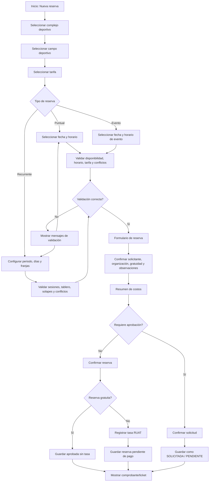
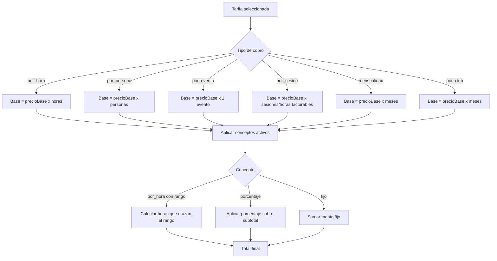
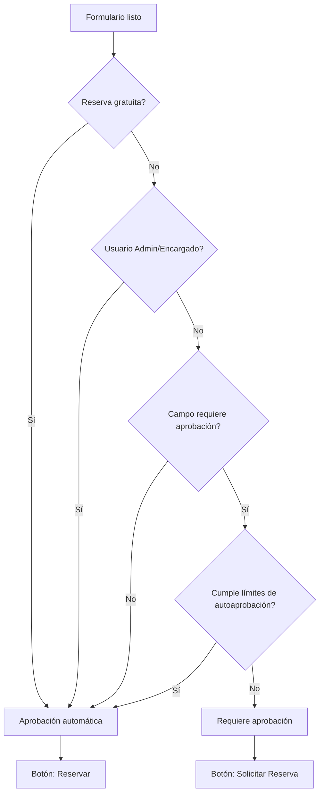

# Flujo de Reservas Deportivas

Este documento resume el flujo funcional de reservas, los puntos de decisión y los casos de uso principales para validar manualmente la experiencia.

## Diagrama General

## Flujo de Costos

## Decisión: Reservar vs Solicitar

## Casos de Uso y Pruebas Manuales

| ID | Caso | Datos mínimos | Resultado esperado |
|---|---|---|---|
| CU-01 | Reserva puntual por hora válida | Tarifa `por_hora`, horario dentro de rango, sin conflictos | Se calcula `precioBase x horas`; botón confirma; formulario muestra subtotal base y total |
| CU-02 | Puntual con tarifa nocturna | Horario cruza rango de concepto nocturno | Concepto muestra rango, horas aplicadas y monto adicional |
| CU-03 | Puntual fuera de horario del campo | Hora fuera de horario fijo/excepción | Se bloquea confirmar y aparece mensaje claro |
| CU-04 | Puntual fuera de rango de tarifa | Hora fuera de `tarifa.desde/hasta` | Se muestra rango permitido de tarifa |
| CU-05 | Puntual con conflicto | Horario ya reservado | Se bloquea confirmar con mensaje de conflicto |
| CU-06 | Evento válido | Tarifa `por_evento`, duración menor o igual a config máxima | Muestra `1 evento`, subtotal base y total |
| CU-07 | Evento excede duración máxima | Duración mayor a `DURACION_MAXIMA_EVENTOS` | Botón queda deshabilitado y muestra mensaje de duración máxima |
| CU-08 | Por persona sin personas | Tarifa `por_persona`, personas vacío | Confirmación bloqueada; personas requerido |
| CU-09 | Por persona con capacidad excedida | Personas > `capacidadPersonas` | Confirmación bloqueada por capacidad máxima |
| CU-10 | Recurrente por sesión | Días/franjas válidas | Sesiones/horas facturables coinciden entre selector y formulario |
| CU-11 | Recurrente mensualidad | Periodo cruza meses | Muestra meses, tarifa mensual y subtotal base |
| CU-12 | Recurrente con fecha personalizada | Editar solo una fecha | Calendario marca fecha modificada; tablero y sesiones se recalculan |
| CU-13 | Recurrente con día personalizado | Editar todos los viernes, por ejemplo | Calendario marca día personalizado; lista derecha refleja cambios |
| CU-14 | Recurrente excluir fecha | Excluir una fecha con sesión | Fecha queda marcada como excluida; sesiones bajan |
| CU-15 | Recurrente mover sesión | Mover sesión a otra fecha válida | Sesión desaparece de origen y aparece en destino |
| CU-16 | Recurrente con solape de franjas | Dos franjas se cruzan | Se bloquea confirmar con mensaje de solape |
| CU-17 | Campo requiere aprobación | Usuario contribuyente y no cumple autoaprobación | Botón/modal dice `Solicitar`; estado pendiente de aprobación |
| CU-18 | Campo autoaprobado | Campo no requiere aprobación o cumple límites | Botón/modal dice `Reservar`; estado aprobación automática |
| CU-19 | Reserva gratuita | Organización autorizada o deportista elite usando beneficio | Total 0; no genera tasa de pago |
| CU-20 | Número de reserva | Formulario abierto | Número aparece bloqueado y auto-generado |

## Checklist de Regresión

- El selector de horario es la fuente del precio calculado.
- El formulario no permite editar fecha/hora que ya definieron el precio.
- `Personas` se muestra siempre en selectores, pero solo es obligatorio para `por_persona`.
- El formulario solo muestra `Personas` si es requerido o si ya fue informado.
- El resumen de costos muestra: tarifa base, precio unitario, cantidad facturable, subtotal base, conceptos y total.
- Los conceptos `por_hora` con rango muestran horas realmente aplicadas.
- La cantidad de sesiones recurrentes coincide entre selector recurrente y formulario.
- El modal final usa `Solicitar` solo cuando requiere aprobación.
- El modal final usa `Reservar` cuando la aprobación es automática.
- El build debe pasar sin warnings de CommonJS ni budget de estilos.
