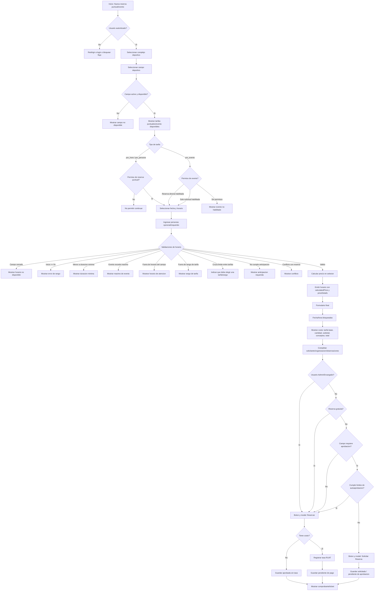
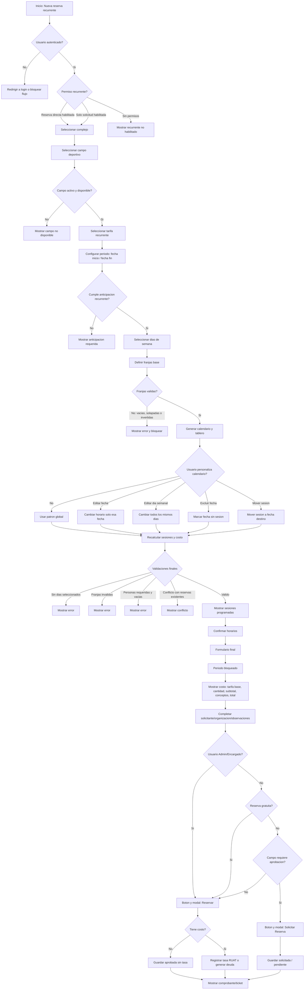
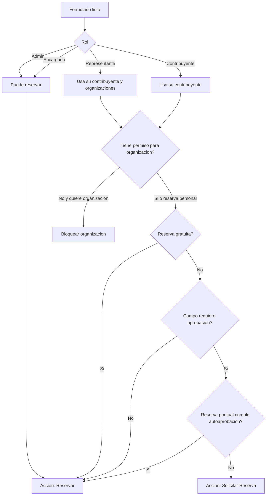
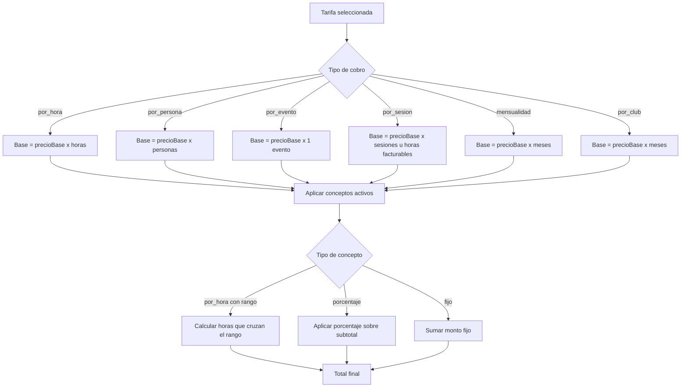

# Flujo de reservas deportivas

Este documento describe los diagramas de flujo principales y las reglas de permisos para probar el registro de reservas. Los flujos se separan en reservas puntuales/eventos y reservas recurrentes, porque cada una valida horarios y permisos de forma distinta.

## Roles y permisos

| Rol | Puede reservar para si mismo | Puede seleccionar contribuyente | Puede usar organizacion | Puede autoaprobar | Puede solicitar si requiere aprobacion |
|---|---:|---:|---:|---:|---:|
| `Admin` | Si | Si | Si | Si | No aplica, puede aprobar automaticamente |
| `Encargado` | Si | Si | Si | Si | No aplica, puede aprobar automaticamente |
| `Representante` | Si | No, usa su contribuyente | Si, sus organizaciones representadas | No | Si |
| `Contribuyente` | Si | No, usa su contribuyente | Solo si tiene organizaciones habilitadas | No | Si |

Permisos/configuraciones que cambian el flujo:

- `HABILITAR_RESERVAS_EVENTOS`: permite reserva directa de eventos.
- `HABILITAR_SOLICITUD_RESERVAS_EVENTOS`: permite solicitud de eventos cuando no se puede reservar directo.
- `HABILITAR_RESERVAS_RECURRENTES`: permite reserva recurrente directa.
- `HABILITAR_SOLICITUD_RESERVAS_RECURRENTES`: permite solicitud recurrente.
- `HABILITAR_RESERVAS_ORGANIZACIONES`: permite reservar para organizaciones.
- `HABILITAR_SOLICITUD_RESERVAS_ORGANIZACIONES`: permite solicitar para organizaciones.
- `campo.requiereAprobacion`: define si el campo puede generar reserva automatica o debe pasar por revision.
- `campo.maxDuracionAutoAprobacion` y `campo.maxPersonasAutoAprobacion`: permiten autoaprobacion si la reserva cumple limites.

## Flujo 1: Registro de Reserva Puntual o Evento



### Condiciones especiales de reserva puntual/evento

| Condicion | Resultado esperado |
|---|---|
| Tarifa `por_persona` sin personas | No permite confirmar horario |
| Personas mayor a `capacidadPersonas` | No permite confirmar horario |
| Tarifa `por_evento` mayor a `DURACION_MAXIMA_EVENTOS` | No permite confirmar y explica la duracion maxima |
| Usuario sin permiso de evento directo, pero con solicitud habilitada | Continua como solicitud |
| Usuario sin permiso directo ni solicitud | No debe poder continuar |
| Campo no requiere aprobacion | Accion final: `Reservar` |
| Campo requiere aprobacion y no cumple limites | Accion final: `Solicitar Reserva` |
| Admin/Encargado | Accion final: `Reservar`, no solicitud |

## Flujo 2: Registro de Reserva Recurrente



### Condiciones especiales de reserva recurrente

| Condicion | Resultado esperado |
|---|---|
| Recurrentes no habilitadas y solicitudes no habilitadas | No puede iniciar flujo |
| Recurrentes directas no habilitadas, solicitudes habilitadas | Puede avanzar como solicitud |
| Usuario Admin/Encargado | Puede reservar directamente si el flujo esta disponible |
| Fecha inicio/fin invalida | No genera calendario valido |
| Ningun dia seleccionado | Bloquea confirmar horarios |
| Franjas solapadas | Bloquea confirmar horarios |
| Fecha personalizada | Calendario marca fecha personalizada y recalcula costo |
| Dia semanal personalizado | Calendario marca dias personalizados y recalcula costo |
| Fecha excluida | Baja sesiones y marca la fecha excluida |
| Mover sesion | Origen queda sin sesion y destino recibe la sesion |
| Tarifa `por_sesion` | Muestra total sesiones/horas facturables y subtotal |
| Tarifa `mensualidad` | Muestra meses y tarifa mensual |
| Tarifa `por_persona` | Personas requerido |

## Diagrama de permisos y accion final



## Calculo de costos

El selector de horario o programacion es la fuente principal del precio. El formulario recibe el total y muestra el desglose para confirmar.



## Validaciones RUAT para tasas municipales

Estas validaciones toman como referencia la especificacion tecnica `RuatServiciosWebTasasOI / tasasOI`. Aunque el backend pueda envolver la respuesta con otro formato, la interfaz debe interpretar estos campos para mostrar mensajes claros.

### Registro de tasa

Metodo RUAT de referencia: `POST registroTasa`.

Campos obligatorios antes de enviar:

| Campo | Origen en el sistema | Validacion esperada | Mensaje sugerido |
|---|---|---|---|
| `codigoAlcaldia` | `CODIGO_ALCALDIA_RUAT` | No vacio; debe corresponder al GAMQ, por ejemplo `QUI` | Falta o no es valida la configuracion de alcaldia RUAT. |
| `codigoUsuario` | `CODIGO_USUARIO_RUAT` | No vacio; usuario RUAT con rol de Registro Tasa / Otro Ingreso | El usuario RUAT no esta configurado o no tiene permisos para registrar tasas. |
| `codigoContribuyente` | Contribuyente seleccionado | No vacio; contribuyente registrado en RUAT | El contribuyente no tiene codigo RUAT valido. Verifique sus datos. |
| `servicioMunicipal` | `SERVICIO_MUNICIPAL_RUAT` | No vacio; debe corresponder al servicio municipal GAMQ, por ejemplo `2174` | El servicio municipal RUAT no esta configurado correctamente. |
| `datosConcepto` | Tarifa / clasificador | Debe tener al menos 1 concepto | La tasa debe tener al menos un concepto. |
| `datosConcepto.numero` | Generado por el sistema | Secuencial desde `1` | El concepto no tiene numero secuencial. |
| `datosConcepto.codigoClasificador` | `tarifa.clasificadorRuatDto.codigo` | No vacio; clasificador valido | La tarifa no tiene clasificador RUAT valido. |
| `datosConcepto.tipoArancel` | `tarifa.clasificadorRuatDto.tipoArancel` | No vacio; debe corresponder al clasificador, normalmente `DI` | El tipo de arancel no corresponde al clasificador RUAT. |
| `datosConcepto.monto` | Total calculado | Mayor a cero y expresado en bolivianos | El monto enviado a RUAT debe ser mayor a cero. |
| `observacion` | Observaciones o descripcion generada | No vacia; describir la reserva | Falta la observacion para registrar la tasa. |

Respuesta esperada cuando RUAT acepta:

```json
{
  "mensaje": null,
  "continuarFlujo": true,
  "numeroTasa": "2542"
}
```

Regla de interfaz:

- Si `continuarFlujo=true` y existe `numeroTasa`, guardar la reserva como pendiente de pago y mostrar el numero de tasa.
- Si `continuarFlujo=false`, no guardar la reserva como confirmada; mostrar `mensaje` traducido a una accion clara.
- Si la respuesta no tiene `payload`, `mensaje`, `continuarFlujo` o `numeroTasa`, mostrar: `RUAT devolvio una respuesta invalida. No se registro la reserva con pago.`

### Consulta de pago de tasa

Metodo RUAT de referencia: `POST consultaPagoTasa`.

Campos obligatorios:

| Campo | Validacion esperada | Mensaje sugerido |
|---|---|---|
| `codigoAlcaldia` | No vacio | Falta la configuracion de alcaldia RUAT. |
| `numeroTasa` | No vacio | La reserva no tiene numero de tasa asociado. |
| `tipoTasa` | Constante `TO` | Tipo de tasa invalido para consulta RUAT. |

Respuesta esperada con pago:

```json
{
  "mensaje": null,
  "continuarFlujo": true,
  "observacion": null,
  "pagoTasa": {
    "numeroTasa": "10192",
    "folio": "2870079883418",
    "formaPago": "PAGO ORIGINAL TOTAL",
    "fechaPago": "01/08/2022",
    "entidadFinanciera": "BANCO SOLIDARIO S.A.-COCHABAMBA-QUILLACOLLO",
    "montoPago": "80",
    "observacion": "CONSOLIDADO"
  }
}
```

Regla de interfaz:

- Si `pagoTasa` existe, validar `numeroTasa`, `folio`, `fechaPago` y `montoPago`; registrar pago local y cambiar la reserva a pagada.
- Si `continuarFlujo=false` o no existe `pagoTasa`, informar que no se encontro pago para esa tasa, sin marcar error tecnico.
- Si `fechaPago` no puede parsearse, no registrar el pago y mostrar que RUAT devolvio una fecha invalida.

### Anulacion de tasa

Metodo RUAT de referencia: `POST anulacionTasa`.

Campos obligatorios:

| Campo | Validacion esperada | Mensaje sugerido |
|---|---|---|
| `codigoAlcaldia` | No vacio | Falta la configuracion de alcaldia RUAT. |
| `codigoUsuario` | No vacio y con permiso RUAT | El usuario RUAT no puede anular tasas. |
| `numeroTasa` | No vacio | La reserva no tiene tasa para anular. |
| `tipoTasa` | Constante `TO` | Tipo de tasa invalido para anulacion. |
| `motivoTasa` | Uno de: `A SOLICITUD DEL CONTRIBUYENTE`, `NO SE EFECTUO EL PAGO EN EL DIA DEL REGISTRO`, `REGISTRO DE DATOS INCONSISTENTES` | Motivo de anulacion no permitido por RUAT. |
| `observacion` | Mayor a 10 caracteres | La observacion de anulacion debe explicar el motivo. |

Regla de interfaz:

- Si `continuarFlujo=true`, mostrar `mensajeConfirmacion` y actualizar la reserva/tasa como anulada.
- Si RUAT responde que la tasa ya tiene anulacion registrada, mostrarlo como advertencia, no como fallo desconocido.
- Si RUAT no responde o expira el token, mantener la reserva sin cambios y permitir reintento.

### Mensajes RUAT normalizados

| Pista del mensaje tecnico | Mensaje para usuario/admin |
|---|---|
| `token`, `Autorizacion`, `Bearer` | La sesion de RUAT no esta disponible o expiro. Vuelva a intentar. |
| `codigoAlcaldia` | Revise la configuracion `CODIGO_ALCALDIA_RUAT`. |
| `codigoUsuario` o rol | El usuario RUAT no tiene permisos para Tasas y Otros Ingresos. |
| `codigoContribuyente` | El contribuyente no esta correctamente vinculado con RUAT. |
| `servicioMunicipal` | El servicio municipal RUAT no corresponde al GAMQ. |
| `clasificador` | La tarifa no tiene un clasificador RUAT valido. |
| `tipoArancel` | El tipo de arancel no corresponde al clasificador. |
| `monto` | El monto debe ser mayor a cero. |
| `numeroTasa` | La tasa no existe o no corresponde al GAMQ. |
| `anulacion` ya registrada | La tasa ya tiene un tramite de anulacion registrado. |

## Casos de uso para pruebas

| ID | Caso | Rol | Permisos/config | Resultado esperado |
|---|---|---|---|---|
| CU-01 | Puntual por hora valida | Contribuyente | Campo no requiere aprobacion | Accion `Reservar`; costo base x horas |
| CU-02 | Puntual requiere aprobacion | Contribuyente | Campo requiere aprobacion y no cumple limites | Accion `Solicitar Reserva` |
| CU-03 | Puntual autoaprobada por limites | Contribuyente | Campo requiere aprobacion, duracion/personas dentro de limites | Accion `Reservar` |
| CU-04 | Puntual admin | Admin | Campo requiere aprobacion | Accion `Reservar` |
| CU-05 | Evento directo habilitado | Contribuyente | `HABILITAR_RESERVAS_EVENTOS=true` | Puede reservar evento |
| CU-06 | Evento solo solicitud | Contribuyente | Directo false, solicitud true | Puede solicitar evento |
| CU-07 | Evento sin permisos | Contribuyente | Directo false, solicitud false | No puede continuar |
| CU-08 | Evento excede duracion maxima | Cualquier rol | `DURACION_MAXIMA_EVENTOS=8` y seleccion 11h | Boton bloqueado y mensaje claro |
| CU-09 | Por persona sin personas | Cualquier rol | Tarifa `por_persona` | Bloquea confirmar |
| CU-10 | Por persona excede capacidad | Cualquier rol | Personas > capacidad | Bloquea por capacidad maxima |
| CU-11 | Recurrente directo habilitado | Admin/Encargado | `HABILITAR_RESERVAS_RECURRENTES=true` | Puede reservar |
| CU-12 | Recurrente solo solicitud | Contribuyente | Directo false, solicitud true | Puede solicitar |
| CU-13 | Recurrente sin permisos | Contribuyente | Directo false, solicitud false | No puede iniciar |
| CU-14 | Recurrente por sesion | Cualquier rol permitido | Franjas validas | Sesiones coinciden entre selector y formulario |
| CU-15 | Recurrente mensualidad | Cualquier rol permitido | Periodo cruza meses | Muestra meses y tarifa mensual |
| CU-16 | Recurrente fecha personalizada | Cualquier rol permitido | Editar solo una fecha | Marca fecha personalizada y recalcula |
| CU-17 | Recurrente dia personalizado | Cualquier rol permitido | Editar todos los viernes | Marca dias personalizados y recalcula |
| CU-18 | Recurrente excluir fecha | Cualquier rol permitido | Excluir fecha con sesion | Baja sesiones |
| CU-19 | Recurrente mover sesion | Cualquier rol permitido | Mover a fecha valida | Origen/destino actualizados |
| CU-20 | Organizacion sin permiso | Contribuyente/Representante | Organizaciones no habilitadas o no representadas | No permite reservar para organizacion |
| CU-21 | Organizacion gratuita | Representante/Admin | Organizacion permite gratuidad | Total 0 |
| CU-22 | Numero de reserva | Cualquier rol | Formulario abierto | Numero bloqueado y auto-generado |
| CU-23 | RUAT registro exitoso | Cualquier rol | `continuarFlujo=true`, `numeroTasa` presente | Guarda reserva pendiente de pago y muestra numero de tasa |
| CU-24 | RUAT rechaza registro | Cualquier rol | `continuarFlujo=false`, `mensaje` presente | No guarda como confirmada y muestra mensaje claro |
| CU-25 | RUAT sin clasificador | Admin/Encargado | Tarifa sin `clasificadorRuatDto.codigo` | Bloquea antes de enviar a RUAT |
| CU-26 | RUAT monto cero | Cualquier rol | Reserva con costo 0 pero no marcada gratuita | Bloquea registro de tasa; monto debe ser mayor a cero |
| CU-27 | RUAT pago encontrado | Admin/Encargado | `pagoTasa` completo | Registra pago local y marca reserva pagada |
| CU-28 | RUAT pago no encontrado | Admin/Encargado | `continuarFlujo=false` o sin `pagoTasa` | Informa sin modificar la reserva |
| CU-29 | RUAT anulacion ya registrada | Admin/Encargado | Mensaje de anulacion existente | Muestra advertencia y no duplica anulacion |

## Checklist de regresion

### Permisos

- Admin y Encargado pueden completar reservas directas cuando el flujo esta disponible.
- Contribuyente y Representante no pueden autoaprobar si el campo exige aprobacion y no cumplen limites.
- Si una funcionalidad esta deshabilitada y tampoco hay solicitud habilitada, no se permite continuar.
- Si solo la solicitud esta habilitada, el flujo debe terminar en `Solicitar Reserva`.
- Organizaciones solo aparecen si el usuario/configuracion lo permite.

### Puntuales/Eventos

- Horario invalido muestra mensaje visible.
- El boton no queda deshabilitado sin explicacion.
- `por_evento` respeta `DURACION_MAXIMA_EVENTOS`.
- `por_persona` exige personas.
- Conflictos con reservas existentes bloquean seleccion.
- El formulario muestra fecha/hora bloqueadas.

### Recurrentes

- Lista `Sesiones Programadas` visible y util.
- Click en sesion selecciona fecha en calendario.
- Editar fecha, editar dia, excluir y mover recalculan tablero y costo.
- Solapes o franjas invalidas bloquean confirmar.
- Calendario distingue patron global, fecha personalizada, dia personalizado, excluido y conflicto.

### Formulario final

- Costo muestra tarifa base, precio unitario, cantidad facturable, subtotal base, conceptos y total.
- El total final coincide con el selector.
- Modal final usa `Reservar` para aprobacion automatica.
- Modal final usa `Solicitar` para aprobacion administrativa.
- Numero de reserva esta bloqueado.
